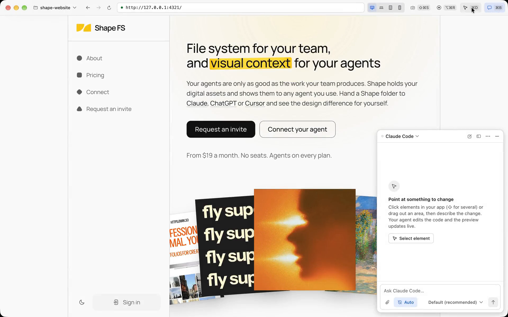

# Gui

Gui is a Mac app for designing real interfaces with the AI coding agent you already use. It runs your project's dev server and shows your app. Point at an element, or drag around an area, and say what to change. Your agent edits your actual code, and the preview updates as it does.

<picture>
  <source media="(prefers-color-scheme: dark)" srcset="www/src/assets/hero-start-dark.png">
  
</picture>

**[Download for Mac](https://usegui.com/download)** · [usegui.com](https://usegui.com) · Apple silicon, alpha

## What it does

- **Point at what to change.** In design mode (⌘D), click elements (⇧ for several) or drag around an area. Each pick goes to the agent with a screenshot, its HTML and styles, and the source file and line it came from.
- **Your agent, your code.** Gui doesn't include a model. It drives the agent on your Mac with your login and your plan, and the agent edits files in your project.
- **Undo any turn.** Gui snapshots your files before and after every turn, so you can undo one, or go back to any earlier message. Your `.git` is never touched.
- **Every screen size.** Desktop fills the window; Laptop, Tablet and Mobile show your app at exactly their size. The agent knows which one you're looking at.
- **The agent can see.** Agents get tools to screenshot, inspect, click and type in the same preview you're looking at, and to play an animation and watch it frame by frame, so they check their own work.
- **Canvases.** Start without a project: ask for a page, or a few versions of one, and compare them side by side on a board.
- **The rest of a dev setup.** Tabs per project, the dev server's logs, your own shell in a terminal, screen recordings, and reference images you paste into the chat.

[Using Gui](docs/using-gui.md) covers every feature and shortcut.

## Agents

Gui speaks the [Agent Client Protocol](https://agentclientprotocol.com) and reuses each agent's own login.

| Agent | How Gui runs it | Sign in |
| --- | --- | --- |
| Claude Code | Bundled adapter. Gui uses your `claude`, or installs the version it needs | From Gui |
| Codex | Bundled adapter. Gui uses your `codex`, or installs the version it needs | From Gui |
| Grok Build | `grok agent stdio` | `grok login` |
| Kiro | `kiro-cli acp` | `kiro-cli login` |
| OpenCode | `opencode acp` | `opencode auth login` |
| Pi | Your `pi` 0.81+, through the bundled [`pi-acp`](https://github.com/svkozak/pi-acp) adapter | `pi`, then `/login` |
| Muse Code | Your `muse`, through the bundled `@bex-co/muse-code-acp` adapter | `muse login` |
| Amp | Your `amp`, through the bundled [`amp-acp`](https://github.com/tao12345666333/amp-acp) adapter | `amp login` |
| Devin | `devin acp` | `devin auth login` |
| Cursor | `cursor-agent acp`, or `agent acp` when that command is Cursor's | `cursor-agent login` |
| fx | `fx acp` | `fx login` |
| jcode | `jcode acp` | `jcode`, which runs its setup |
| Gemini CLI | `gemini --acp` | `gemini`, or `GEMINI_API_KEY` |

Gui runs the agents it finds on your PATH, and offers a Sign in button that runs the login for you. Any other ACP agent can be added in **Settings → Agents**.

## Build from source

You need macOS, [Bun](https://bun.sh) 1.4+, git (Xcode Command Line Tools) and at least one agent from the table.

```bash
git clone https://github.com/brijr/gui.git
cd gui
bun install
bun run dev
```

To install your build as `/Applications/Gui.app`, with the `gui` terminal command that opens a folder in it, run `bun run install-app`. Packaging needs Xcode 26+. Builds from source don't ask for a Gui account, don't take updates from usegui.com, and never send crash reports; only official releases do.

Connecting GitHub to clone your repositories needs the account service in `accounts/`. Cloning by address works without it. See [account service setup](accounts/README.md).

## Development

| Command | What it does |
| --- | --- |
| `bun run dev` | The app with hot reload |
| `bun run check` | Type checks, lint, architecture rules, fast tests and the account service's tests. Run it before every pull request |
| `bun run test:e2e` | End-to-end tests against real dev servers. Agent turns run only with `GUI_E2E_AGENT=<agent id>`, since they use your real usage |
| `bun run test:fast` | Lifecycle, IPC, persistence and chat checks without launching Electron |
| `bun run build` | Production bundle in `out/` |
| `bun run dist` | Packaged app in `release/` ([packaging and releases](docs/releasing.md)) |

The code is in four parts: the Electron main process in `src/main`, preloads in `src/preload`, the UI in `src/renderer`, and shared types in `src/shared`. The website is `www/` and the account service is `accounts/`. [How Gui works](docs/architecture.md) explains each part, and [AGENTS.md](AGENTS.md) has the rules the code keeps.

## Security model

The preview runs your app plus whatever third-party scripts it loads, so it is treated as semi-trusted. It never gets the preload Gui's own UI uses, and Gui's own messages are accepted from the window or tab page that sent them, which a preview is not. Its session denies permission requests (camera, clipboard reads, devices, external protocols) by default, and element picking only works on local origins.

The preview has a small preload of its own (`src/preload/preview.ts`), for editing text in place and for the rulers. It runs in an isolated world and exposes nothing to the page: no `contextBridge` API and no globals, so page scripts can't call it or read what it sends. It listens to main and to the page's events, and sends main four messages: the text of the element where design mode was double-clicked, when it holds only text (main sends the point; the page's own double-clicks never start an edit), to start an edit; how that edit ended (the new text, or nothing); how far the page is scrolled, so guides stay with the content; and ⇧R pressed outside anything that takes typing, to show or hide the rulers. An edit starts only from main, after a double-click in design mode's overlay (Gui's own view over the page, which the page can't reach), and the rulers switch only on a real key press (`isTrusted`), not on events a script dispatched. Main takes these messages only from the top frame of a view that a tab owns as its preview, and checks the arguments: finite numbers, and text of at most 4,000 characters. An edit starts only in an open project or canvas frame, on a local address, at the point main just asked about, one at a time, and its end must carry the id main issued. Main finds the element itself through the DevTools protocol. The rest comes from the page, and its scripts can change all of it: the old text, the new text, and which file wrote the element (React's debug data, or Astro's source attributes). So main trusts none of it. A rewrite it makes is a turn of its own in the chat, checkpointed before and after like the agent's, so Undo puts the file back. It rewrites the file itself only to swap plain text for plain text: the file must be JSX, Astro or HTML; the old text must be all that one element holds there, between its own opening and closing tags and not in a `<script>` or `<style>`; and neither text may hold anything that isn't literal wherever markup can sit (`<`, `>`, braces, backslashes, character references, percent escapes, a comment's end, control characters, or a quote that could close a string or attribute the markup is inside). String literals, attribute values, code that happens to read the same, and every other file in the project are left alone, so a rewrite can change the wording of one element and nothing else. Any other edit goes to the agent, and not as your words: the message is Gui's own fixed text ("Change this text."), and the old and new text travel in a `<text_edit_…>` block, one line each, fenced and marked as untrusted the same as selected-element context. They stay apart from a queued message's text, also when you edit it.

The terminals are your own shell, started only when you open one, at the project root; nothing the project defines runs in them on its own (your shell's startup files run as they do in Terminal, so tools hooked into them, like direnv, react to the folder as usual). Only the window's own UI can type into them.

Agents get Gui's preview tools over a loopback MCP server that needs a token made for each project opening and rejects other `Host` headers. The page tools act on your app at its local address, or on a public website the agent opens (`preview_open_website`; in a canvas, `canvas_screenshot_url`), which you're asked to allow each time. Agents whose own settings decide what they ask (Amp, fx, Kiro, OpenCode, Pi) aren't offered `preview_open_website`, since Gui can't make them ask first. A website loads in a view with no preload, in a separate signed-out session that is kept in memory and wiped when it closes: public addresses only, with no permissions, downloads or form posts. Everything they return from the page or dev server (element data, console, logs) is fenced and marked as untrusted, the same as selected-element context. Claude's preview tools are pre-allowed by exact name, except the two that open websites; nothing is auto-approved by matching a tool's title, and Gui never approves a website tool by itself, in Auto mode either. Chat history is stored owner-only (`0600`), without URL query strings.

**Auto** (on by default, per project) approves the agent's requests to edit project files and run commands. It still asks about files outside the project, sensitive files (build, tool and deploy config, dotfiles, dependency manifests and lockfiles, scripts, Dockerfiles, git hooks) and anything the agent itself flags. Commands aren't sandboxed. In **Ask** (⇧⌘A), Gui still approves edits to ordinary project files, and asks you about everything else.

## Not yet

Drawing on a picked area, quick direct-manipulation tweaks, Vue/Svelte source mapping, exact Next.js webpack mapping, and parallel variations.

## Contributing

Issues and pull requests are welcome. Run `bun run check` before you open one. Report security issues privately, as [SECURITY.md](SECURITY.md) describes.

## License

[Apache License 2.0](LICENSE). The Gui name and logo aren't covered by the license; please don't use them for a fork. Agent logos belong to their owners.
